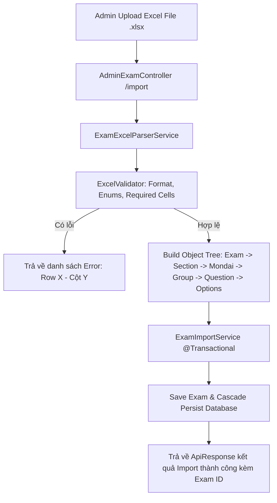

# Kế hoạch triển khai Chức năng Import Đề Thi JLPT từ Excel

## 1. Tổng quan & Mục tiêu

Hệ thống đã có đầy đủ cấu trúc Entity cho bài thi JLPT:
- **`Exam`** (id, title, level, durationMinutes, published)
- **`Section`** (exam_id, sectionType: VOCAB / GRAMMAR / READING / LISTENING, orderNo, audioUrl)
- **`Mondai`** (section_id, mondaiNo, orderNo, instruction)
- **`QuestionGroup`** (mondai_id, orderNo, passage, imageUrl, transcript)
- **`Question`** (group_id, exam_id, orderNo, questionNo, content, explanation)
- **`QuestionOption`** (question_id, optionNo, optionText, imageUrl, isCorrect)

**Mục tiêu**:
1. Xây dựng cấu trúc file Excel chuẩn, dễ nhập liệu cho giáo viên / admin, hỗ trợ đầy đủ các dạng bài JLPT (đọc hiểu có bài đọc passage, nghe hiểu có audio_url/transcript, câu hỏi đơn lẻ, trắc nghiệm 4 đáp án).
2. Thiết kế module đọc file Excel (`Apache POI`), validate dữ liệu chặt chẽ (format, enum, liên kết quan hệ cha-con).
3. Triển khai API Import Exam (kèm Transactional rollback nếu có bất kỳ dòng nào lỗi) và API tải template mẫu (`/api/v1/admin/exams/template`).

---

## 2. Thiết kế Cấu trúc File Excel Template

Để giáo viên dễ nhập liệu nhất, có 2 phương án thiết kế cấu trúc file Excel:

### Phương án A: Multi-Sheet (Khuyên dùng - Chuẩn hoá dữ liệu cao nhất)
Chia thành **2 Sheet**:
1. **Sheet `Exam_Info`**: Khai báo thông tin đề thi chung.
   - Các cột: `Title` | `Level` (N1..N5) | `DurationMinutes`
2. **Sheet `Questions`**: Danh sách tất cả câu hỏi theo thứ tự cấu trúc đề.
   - Các cột:
     - `Section`: Loại phần thi (`VOCAB`, `GRAMMAR`, `READING`, `LISTENING`)
     - `Section Audio`: Đường dẫn file audio cho Section (dành cho Listening, chỉ cần điền ở dòng đầu tiên của Section)
     - `Mondai No`: Số thứ tự mondai (1, 2, 3...)
     - `Mondai Instruction`: Hướng dẫn làm bài (vd: "つぎの ぶんの ....")
     - `Group Id`: Mã nhóm nội bộ trong file (vd: `G1`, `G2` hoặc để trống nếu là câu hỏi độc lập) để nhóm các câu hỏi cùng bài đọc / tranh
     - `Passage`: Đoạn văn bài đọc (chỉ cần điền 1 lần cho Group)
     - `Image Url`: URL hình ảnh đính kèm (nếu có)
     - `Transcript`: Lời thoại phần nghe (nếu có)
     - `Question No`: Số thứ tự câu trong đề (1, 2, 3... 60)
     - `Question Content`: Nội dung câu hỏi
     - `Explanation`: Giải thích đáp án chi tiết
     - `Option 1`: Nội dung lựa chọn 1
     - `Option 2`: Nội dung lựa chọn 2
     - `Option 3`: Nội dung lựa chọn 3
     - `Option 4`: Nội dung lựa chọn 4
     - `Correct Option`: Đáp án đúng (1, 2, 3, hoặc 4)

> [!TIP]
> **Ưu điểm Phương án A**: Tất cả câu hỏi nằm trên 1 bảng dễ quản lý, copy/paste, tìm kiếm. Sheet Exam_Info tách biệt metadata. Parser dễ dàng duyệt tuần tự từ trên xuống dưới gom nhóm theo `Section` -> `Mondai` -> `Group` -> `Question`.

---

## 3. Kiến trúc Luồng Xử Lý (Workflow & Component Architecture)



### Các bước validation quan trọng:
1. **File check**: Kiểm tra định dạng `.xlsx`, dung lượng file cho phép (< 10MB).
2. **Header check**: Kiểm tra tên sheet và tên các cột bắt buộc.
3. **Data check**:
   - `Level`: Phải thuộc `N1`, `N2`, `N3`, `N4`, `N5`.
   - `Section`: Phải thuộc `VOCAB`, `GRAMMAR`, `READING`, `LISTENING`.
   - `Question No`: Phải là số nguyên dương và không được trùng lặp trong cùng một đề.
   - `Option 1..4`: Không được rỗng.
   - `Correct Option`: Phải là giá trị số trong khoảng `[1, 4]`.
   - Báo lỗi chi tiết: dòng số bao nhiêu, cột nào, lỗi gì để admin sửa trực tiếp trên file Excel.

---

## 4. Các Thay Đổi Cần Triển Khai Trong Codebase

### 4.1. Thêm Thư viện vào `pom.xml`
Thêm thư viện xử lý Excel:
- `org.apache.poi:poi-ooxml` (bản mới nhất tương thích Java 21/Spring Boot 3.5+, vd: `5.3.0` hoặc `5.2.5`).

### 4.2. Cấu trúc Package Mới:
```
kaito.jlpt.ktjlpt
├── dto
│   ├── excel
│   │   ├── ExamImportRowDto.java       // DTO map từng dòng của Sheet Questions
│   │   ├── ExamMetaSheetDto.java       // DTO map Sheet Exam_Info
│   │   └── ExcelImportErrorDto.java     // Chứa thông tin lỗi (row, column, message)
│   └── response
│       └── ExamImportResponse.java     // Response trả về số câu hỏi, section đã import
├── service
│   ├── excel
│   │   ├── ExcelHelper.java            // Utilities đọc Cell (String, Numeric, Date...)
│   │   ├── ExamExcelParser.java        // Đọc Workbook -> DTO Tree
│   │   └── ExamTemplateGenerator.java  // Tự động tạo file Excel template mẫu chuẩn để tải về
│   └── ExamImportService.java          // Xử lý logic nghiệp vụ và persist Entity
└── controller
    └── AdminExamController.java        // Endpoints: POST /import, GET /template
```

### 4.3. Các Endpoint Mới:
- `POST /api/v1/admin/exams/import` (MultipartFile file) -> Nhận file excel, parse và lưu đề thi.
- `GET /api/v1/admin/exams/template` -> Tải file Excel mẫu chuẩn đã điền sẵn 1 vài dòng demo.

---

## 5. Kế hoạch Kiểm Thử (Verification Plan)
1. **Tạo Unit/Integration Tests**:
   - Test đọc file template hợp lệ -> Kiểm tra số lượng `Section`, `Mondai`, `Question`, `Option` được lưu vào DB.
   - Test validation lỗi: Sheet thiếu cột, `Correct Option` ngoài khoảng [1, 4], thiếu nội dung câu hỏi... Đảm bảo transaction rollback hoàn toàn.
2. **Kiểm tra API Thực tế**:
   - Chạy ứng dụng, gọi GET `/api/v1/admin/exams/template` để sinh file template.
   - Điền dữ liệu một đề thi mẫu JLPT N3 và gọi POST `/api/v1/admin/exams/import`.
   - Gọi lại GET `/api/v1/exams/{examId}` kiểm tra cấu trúc cây bài thi trả về chuẩn xác.
